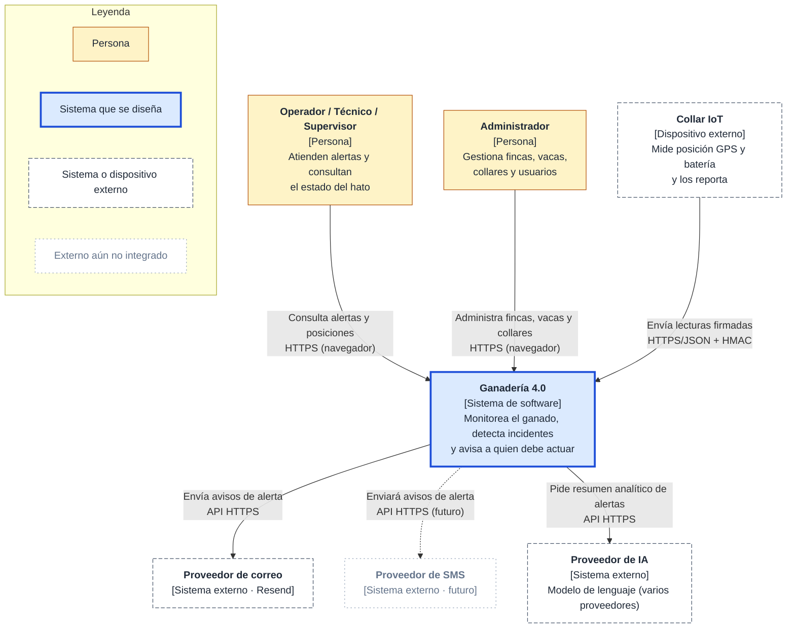
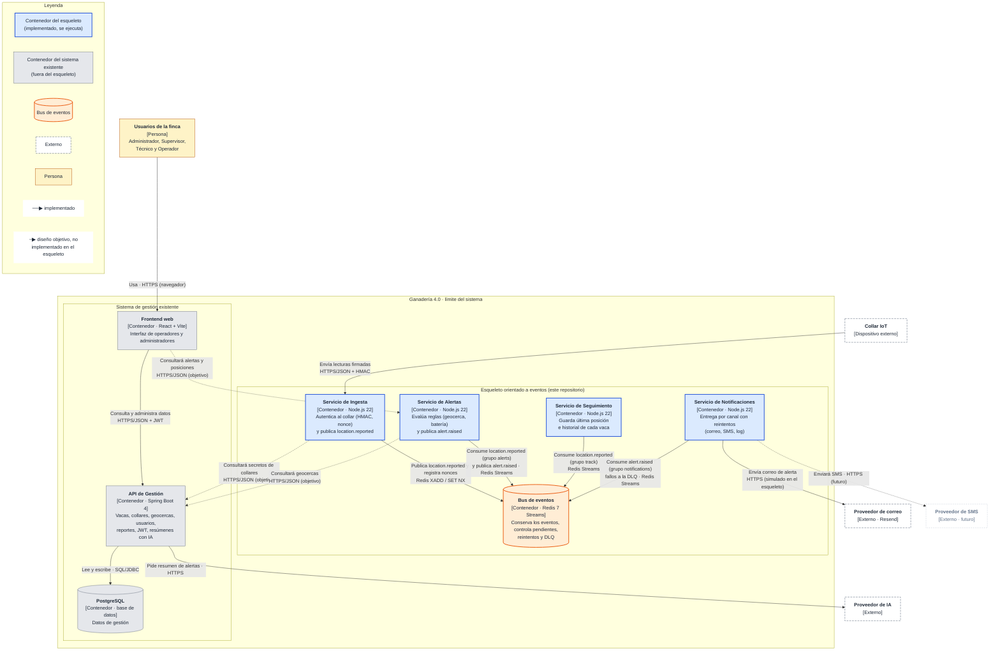
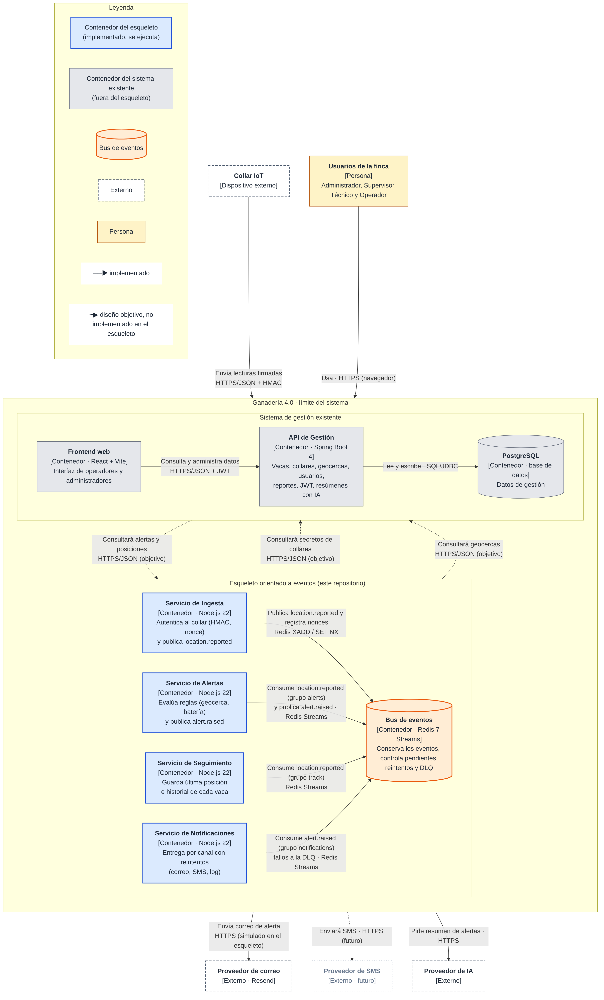

# 4 · Diagramas C4 (niveles 1 y 2)

> Pieza del entregable: **Diagramas C4**, niveles 1 y 2, con cajas y flechas anotadas y leyenda.
> Las imágenes para diapositivas están en `docs/img/` (`c4-nivel1-contexto.png`, `c4-nivel2-contenedores.png`);
> los diagramas de abajo se renderizan solos en GitHub (Mermaid) y su fuente está en los archivos `.mmd`.

**Convenciones.** Cada **caja** indica nombre, tipo, tecnología y una línea de responsabilidad. Cada **flecha** indica
hacia dónde va (el sentido importa), qué hace (un verbo concreto) y por qué medio viaja. La **leyenda** explica colores y
estilos de línea.

---

## Nivel 1 · Contexto

El sistema como **una sola caja**; alrededor, solo personas y sistemas externos. Aquí no aparece ninguna base de datos
ni servicio interno.

---

## Nivel 2 · Contenedores

Se abre la caja del sistema y se muestran las piezas que se despliegan por separado. Hay dos grupos:

- **Esqueleto orientado a eventos** (azul): lo que implementa este repositorio y **se ejecuta** con `docker compose up`.
- **Sistema de gestión existente** (gris): el backend Spring Boot + PostgreSQL + frontend que ya existen. No se reescriben.

Las flechas **punteadas** son el diseño objetivo que el esqueleto **no** implementa todavía (en su lugar usa la semilla
`shared/seed.js`). Está dicho en el README y en el ADR-002.

### Lectura rápida de las flechas clave

| Flecha | Qué hace | Medio | Por qué importa |
|---|---|---|---|
| Collar → Ingesta | Envía lecturas firmadas | HTTPS/JSON + HMAC | Frontera de seguridad (S1, E2) |
| Ingesta → Bus | Publica `location.reported` | Redis Streams | Ingesta no conoce a los consumidores (D2, ADR-001) |
| Alertas → Bus | Consume `location.reported` y publica `alert.raised` | Redis Streams | Primer consumidor; produce el segundo evento |
| Seguimiento → Bus | Consume `location.reported` | Redis Streams | **Segundo consumidor independiente** del mismo evento |
| Notificaciones → Bus | Consume `alert.raised`; manda los fallos a la DLQ | Redis Streams | Reintentos y DLQ (D1, ADR-003) |
| Notificaciones → Proveedor de correo | Envía el correo de alerta | HTTPS (simulado en el esqueleto) | Es lo que falla en E1 |

Los consumidores **inician** la comunicación (leen del bus), por eso las flechas van de cada servicio hacia el bus.
